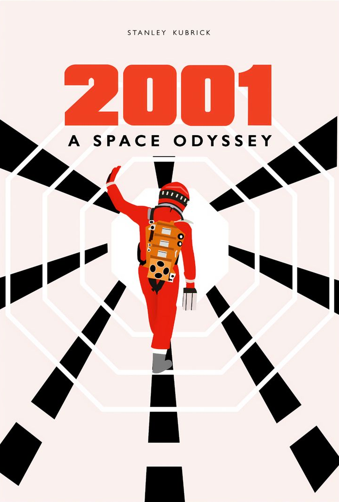
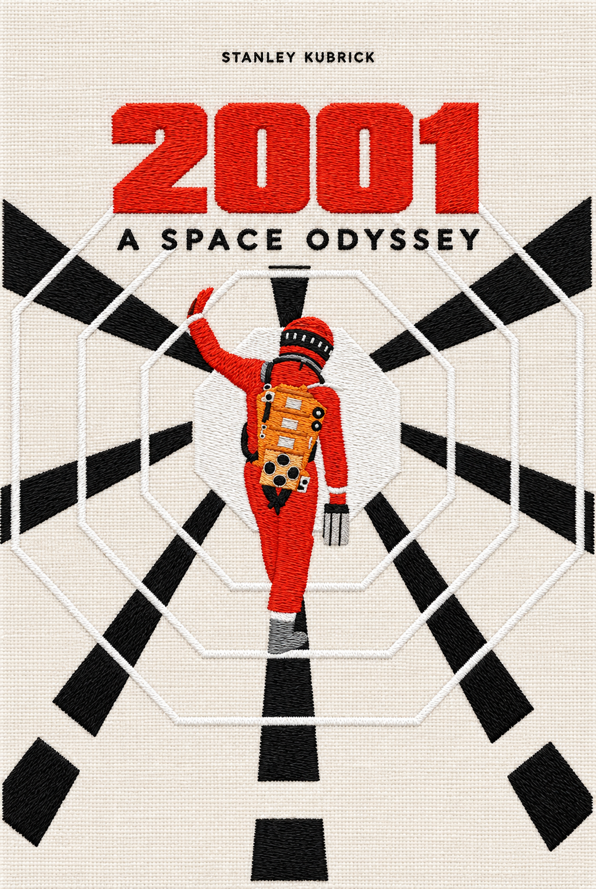
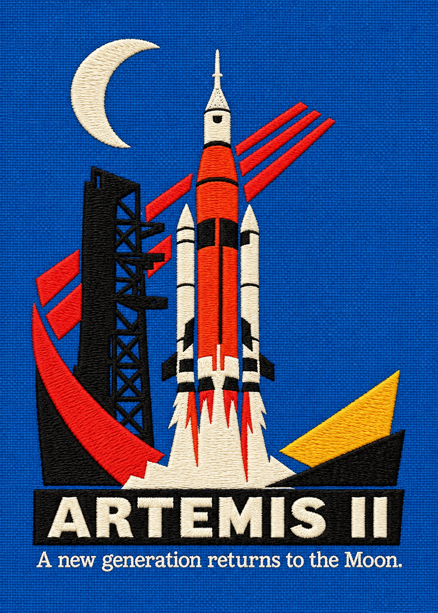
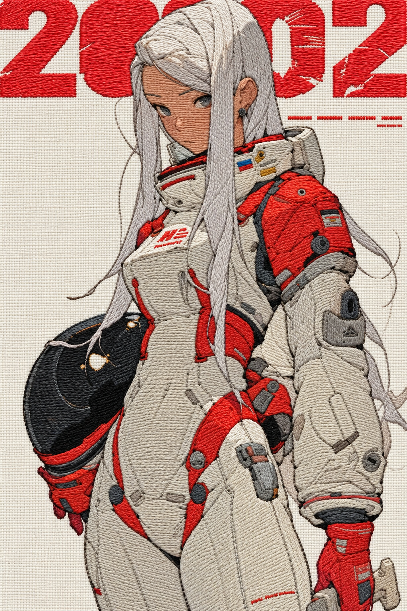

# Fabric and Embroidery Conversion · 布纹刺绣

将平面图片转换为“背景布纹、前景刺绣”的视觉效果，尽量保留原图文字、配色、轮廓和排版。

Turn flat artwork into realistic fabric-and-embroidery visuals while preserving the original design.

## 效果展示 / Examples

以下是提供的原图与处理结果。生成效果可能存在细节差异。

| 示例 | 原图 / Before | 刺绣效果 / After |
| --- | --- | --- |
| star-wars |  |  |
| space-odyssey |  |  |
| back-to-the-future |  |  |
| artemis |  |  |
| character |  |  |

## 安装 / Installation

点击 Code → Download ZIP 并解压，将解压后的仓库文件夹重命名为 `fabric-embroidery`，再放入项目的 `.agents/skills/` 目录。确保入口位置为 `.agents/skills/fabric-embroidery/SKILL.md`。

Download and extract the repository ZIP, rename its folder to `fabric-embroidery`, and copy it into your project's `.agents/skills/` directory. The entry point should be `.agents/skills/fabric-embroidery/SKILL.md`.

## 使用 / Usage

上传图片，调用 `fabric-embroidery`，例如：

> 将这张图片转换成布纹刺绣效果，保留原图文字、配色和排版。

> Use fabric-embroidery to convert this image into realistic fabric and embroidery, preserving its text, colors, and layout.

运行环境必须有可用的图片编辑工具。本技能提供工作流程和提示词，不包含图像生成服务、API 密钥或付费额度。生成质量取决于使用的图像模型，无法保证像素级一致。

An image-editing tool is required. This skill contains workflow instructions and a prompt, not an image service or API credentials. Results depend on the image model and may vary.

## 文件 / Files

- `SKILL.md`: 技能入口与工作流程。
- `conversion-prompt.md`: 原始英文转换提示词。
- `*-before.png` / `*-after.png`: 五组处理前后示例。

## 输出范围 / Scope

输出 PNG 视觉效果图，不生成 DST、PES 等刺绣机针迹文件。示例中的品牌、角色和原始作品归各自权利人所有；本仓库不授予这些素材的使用权。

Outputs are visual mockups, not embroidery-machine stitch files. Example artwork, characters, and trademarks belong to their respective owners; this repository does not grant rights to them.
